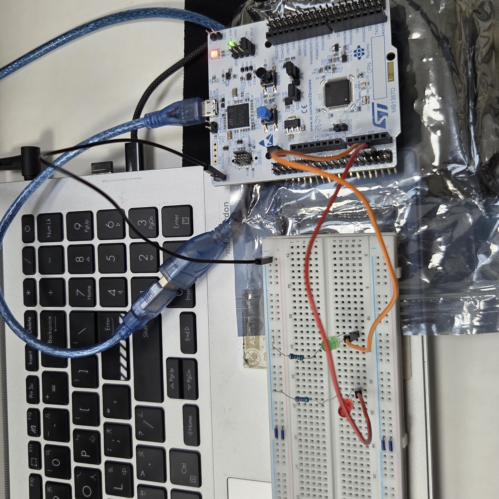
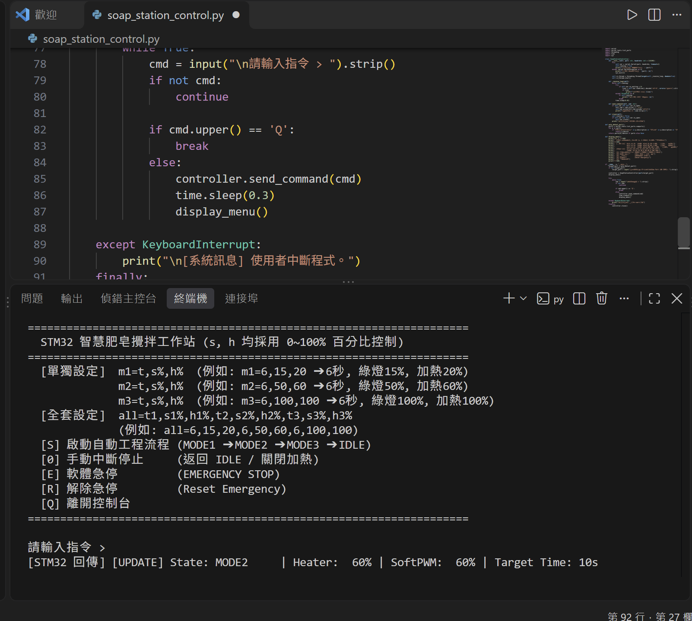
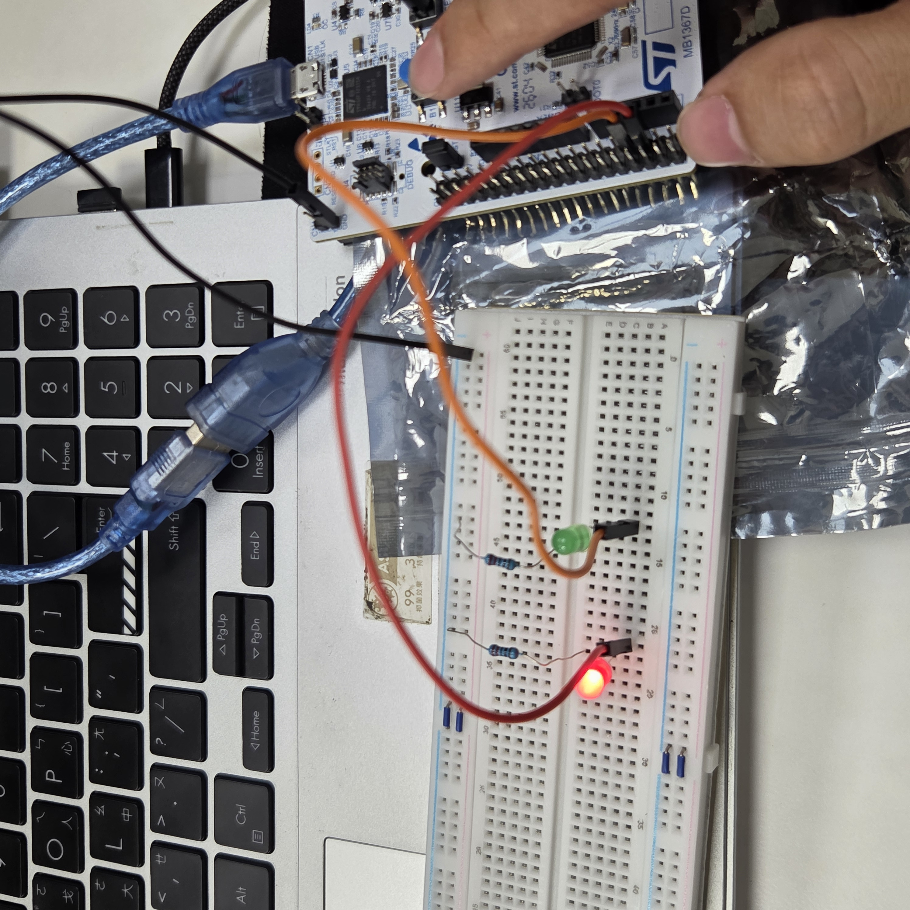

# 智慧肥皂攪拌工作站 (NUCLEO-G474RE 期中專題)

針對手工皂坊現場痛點設計的自動化 Soap Mixing 攪拌工作站：透過 STM32G474RE 實現多階段溫控、攪拌防泡、雙重急停與容錯串口傳輸。

## 1. 情境故事：誰、在哪、遇到什麼麻煩
手工皂坊在現場製作過程中，經常面臨以下四大現場痛點：
- **溫度失控焦黃**：加熱過高導致皂基變質損壞，破壞天然成分與賣相。
- **轉速過快起泡**：機械亂攪打入大量氣泡，造成成品內部空洞毀損。
- **工安應變不及**：機械卡住缺乏即時煞停，引發過載與工安風險。
- **傳輸干擾漏字**：中控配方參數傳輸丟失，導致全自動流程失控。

本專題開發智慧肥皂攪拌工作站，透過 FSM 精準時序流轉、TIM3 硬體 PWM 控溫、PC13 EXTI 極速急停與 Line Buffer 串口指令驗證，切實解決上述問題。

## 2. 替身對照：故事裡的模組 → 板上替身
- **攪拌馬達轉速** → PA4 (綠燈) 閃爍頻率（閃爍越快代表轉速越高，避免過快起泡）。
- **皂液模擬溫度** → PA4 (綠燈) 軟體 PWM 導通亮度（亮度越高代表溫度越高，避免焦黃變質）。
- **實體加熱棒** → PA6 (TIM3 CH1 硬體 PWM，1kHz 穩定加熱，防止溫控失控)。
- **現場工安急停鈕** → PC13 按鈕 (EXTI13 上升沿觸發 + 軟體 150ms 去彈跳，應對突發卡機)。
- **急停警告燈** → PB0 (紅燈，急停時強制亮起)。
- **中控配方終端** → LPUART1 (PA2/PA3 via ST-LINK VCP) 連接 VS Code (Python `pyserial`) 控制台。

## 3. 功能與驗收條件：動作、預期、實測結果
1. **防爆泡/防焦黃序列流轉**：輸入 `S` 後自動由 `MODE1` (低溫慢速) ➔ `MODE2` (中溫中速) ➔ `MODE3` (高溫快速) 流轉，最終回到 `IDLE` 待機。
2. **防干擾動態配方寫入**：支援 `all=t1,s1%,h1%,t2,s2%,h2%,t3,s3%,h3%` 與 `m1=`/`m2=`/`m3=` 指令，搭配換行符緩衝，避免傳輸漏字造成流程失控。
3. **極速工安保護**：按下 PC13 或發送 `E` 指令，立刻切斷加熱與攪拌並亮起 PB0 紅燈；必須輸入 `R` 驗證後方可解鎖復位。
4. **事件驅動 Telemetry**：僅在狀態或參數改變時回傳 `[UPDATE]` 訊息，避免無謂通訊佔用頻寬。

## 4. 用到的技術：第 3 ~ 7 週勾選表
- [x] **System Clock (RCC)**：內部 HSI (16MHz) 經 PLL 倍頻至 170MHz 系統時脈。
- [x] **GPIO Output/Input**：PA4 (綠燈)、PB0 (紅燈) 輸出，PC13 輸入。
- [x] **EXTI (外部中斷)**：PC13 觸發 EXTI line[15:10] 中斷，具備時間濾波與電位確認。
- [x] **TIM (Timer PWM)**：TIM3 CH1 (PA6) 產生 1kHz 硬體 PWM (PSC=169, ARR=999)。
- [x] **LPUART (串口通訊)**：LPUART1 (PA2/PA3) 115200 8N1，開啟 Rx 中斷與 `printf` 重定向。
- [x] **FSM (有限狀態機)**：全程採用非阻塞 `HAL_GetTick()` 實現，嚴禁使用 `HAL_Delay()`。

## 5. 腳位表：用到的每支腳與用途
- **PA4** = `GREEN_LED` (GPIO Output，軟體 PWM 亮度 + 閃爍速度)
- **PA6** = `HEATER_PWM` (TIM3_CH1，1kHz 硬體 PWM 加熱控制)
- **PB0** = `RED_LED` (GPIO Output，急停紅燈指示)
- **PC13** = `USER_BTN` (GPIO_EXTI13，上升沿觸發 + Pull-down 按鈕急停)
- **PA2** = `LPUART1_TX` (ST-LINK Virtual COM Port 傳送數據)
- **PA3** = `LPUART1_RX` (ST-LINK Virtual COM Port 接收指令)

## 6. 建置與執行：開發環境、燒錄步驟、終端機設定、命令
1. **開發環境**：STM32CubeIDE v1.13+、VS Code (Python 3.x, `pyserial`)。
2. **燒錄步驟**：開啟 STM32CubeIDE 專案並將編譯結果燒錄至 NUCLEO-G474RE。
3. **啟動 Python 控制台**：
   pip install pyserial
   python soap_station_control.py
4. **測試指令範例**：
   - `all=6,15,20,6,50,60,6,100,100`：寫入全套防焦黃/防爆泡配方。
   - `m1=6,15,20`：單獨修改 MODE 1 配方。
   - `S`：啟動自動工作流 / `E`：觸發急停 / `R`：解除急停。

## 7. 程式結構：哪個檔做什麼、ISR 與主迴圈分工
- `Core/Src/main.c`：核心 FSM 與硬體控制邏輯。
- `HAL_UART_RxCpltCallback()` [ISR]：非阻塞串口接收，將接收字串寫入 Line Buffer，防止字串丟失。
- `HAL_GPIO_EXTI_Callback()` [ISR]：按鈕急停中斷，經過去彈跳後觸發 `Change_State(STATE_EMERGENCY)`。
- `main()` 主迴圈：執行 `Process_Command()`、`Process_FSM_Logic()` 與 `Update_SoftPWM_And_Blink()`。
- `soap_station_control.py`：VS Code Python 控制台，背景執行緒即時接收 ACK 回應。

## 8. 實作照片：每張附一行圖說

*圖說：NUCLEO-G474RE 實體開發板，連接 PA4 (綠燈)、PB0 (紅燈) 與 ST-LINK 線路。*

*圖說：VS Code 終端機執行 `soap_station_control.py`，成功發送動態配方並接收 ACK 回傳。*

*圖說：按下 PC13 按鈕觸發工安急停狀態，PB0 紅燈高亮起，系統切斷所有加熱與攪拌輸出。*

## 9. 已知限制：哪些用替身、換真貨要改哪裡
1. **加熱與攪拌替身**：目前以 PA4 綠燈閃爍與 PWM 亮度作視覺替身。換真貨時需將 PA6 TIM3 PWM 接至大功率 MOS 驅動板控制加熱棒，並新增 PWM 通道驅動攪拌馬達。
2. **工安急停機制**：目前使用板載 PC13 按鈕。工業級設備應換為實體 NC（常閉）急停開關，並於中斷內直接切斷總電源繼電器。
